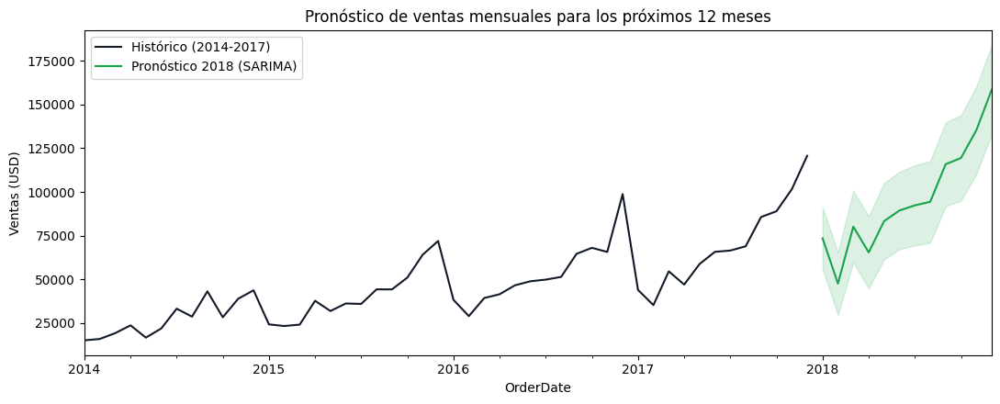

# Pronóstico de Ventas: SARIMA vs. Deep Learning (LSTM)

Pronóstico de la demanda mensual de una tienda retail comparando 6 modelos de series de tiempo, desde un modelo base hasta Deep Learning, para planificar inventario y campañas de temporada alta.



## Problema
El negocio tiene una estacionalidad marcada, con picos fuertes en noviembre y diciembre. Un promedio simple no la captura, así que se necesita un modelo que anticipe la demanda mes a mes.

## Datos
- **Fuente:** [Superstore Sales Dataset – Kaggle](https://www.kaggle.com/datasets/rohitsahoo/sales-forecasting)
- **Volumen:** 9,994 transacciones (~USD 2.3 M), 48 meses (2014–2017)
- **Validación:** 2014–2016 para entrenar y 2017 como prueba (división cronológica)

## Resultados

| Modelo | RMSE (USD) | MAPE |
|---|---:|---:|
| **SARIMA(1,1,1)(1,1,1)[12]** ✅ | 9,204 | **10.6 %** |
| Auto-ARIMA(1,1,1)(0,1,0)[12] | 9,004 | 11.8 % |
| Prophet | 11,244 | 13.0 % |
| ARIMA(12,1,3) | 16,139 | 21.4 % |
| LSTM (ventana 6 meses) | 37,293 | 62.6 % |
| Naive (modelo base) | 37,650 | 62.7 % |

**Conclusiones clave**
- Los modelos con **componente estacional** (SARIMA, Auto-ARIMA y Prophet) bajan el error de ~63 % a ~11 %.
- La **LSTM no supera al modelo base**: con solo 36 meses de entrenamiento no tiene datos suficientes. El Deep Learning rinde mejor con series largas o con muchas series relacionadas.
- Se eligió **SARIMA** por su precisión, porque se reentrena rápido y porque es fácil de explicar al negocio.

## Herramientas
Python · Pandas · NumPy · Matplotlib · Statsmodels · pmdarima · Prophet · TensorFlow/Keras · Scikit-learn

## Estructura
```
├── data/raw/             
├── notebooks/
│   └── sales_forecasting.ipynb
├── reports/
│   ├── figures/            
│   ├── model_comparison.csv
│   └── forecast_2018.csv
└── requirements.txt
```

## Cómo ejecutarlo
1. Descarga el dataset de Kaggle y guárdalo como `data/raw/superstore_sales.csv`.
2. Instala las dependencias: `pip install -r requirements.txt`
3. Abre `notebooks/sales_forecasting.ipynb` en Jupyter o Google Colab.

